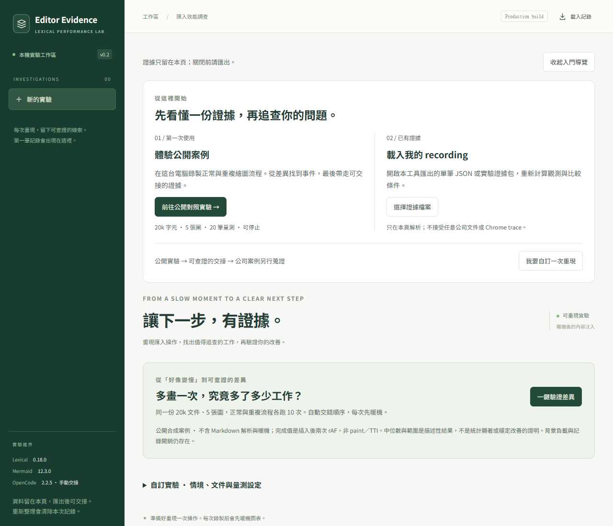

# Editor Evidence · v0.2

**第一次來？從 [START-HERE.md](START-HERE.md) 開始。** 有可直接貼給 agent 的起始指令、五步體驗、安裝受阻時的零依賴範例，以及公司案例的蒐證入口。

**準備到公司接續？** [公司起始 prompt](docs/COMPANY-START.md) 串起環境檢查、[獨立 Mermaid／Pele 比較](experiments/renderer-comparison/README.md) 與 [editor 最小接入契約](docs/EDITOR-INTEGRATION.md)。Renderer 實驗有自己的 lockfile，主工作台與 OpenCode plugin 不需要安裝 Pele；兩種證據格式分開處理。

重現一次 Lexical 內容注入，保留事件證據，找出下一個值得做的實驗，再比較結果。這是可操作的診斷原型，使用混合格式工程文件、真實 Lexical nodes 與 5–10 張不同布局的 Mermaid 圖。

**固定版本：Lexical 0.18.0、React 18.3.1、Mermaid 12.3.0。** OpenCode 2.2.5 Web 已有一次本機 Windows 接合驗證，包含兩個獨立 session；新環境仍需重驗，agent 判讀仍需審查。[本機證據摘要](docs/WINDOWS-VALIDATION.md)。公開案例不能證明公司專案的根因。

[驗證紀錄](docs/VALIDATION.md) · [探索決策](docs/EXPLORATION.md) · [手機畫面](docs/assets/findings-mobile.png)



新版介面提供公開案例／載入記錄雙入口、按需展開的自訂設定、配對摘要與事件返回路徑、鍵盤分頁，以及逐步交接指南。[設計規範](DESIGN.md) · [本輪 UX 驗證](docs/UX-VALIDATION.md)。

## 啟動

使用 Node.js 24。內網環境先準備 lockfile 對應的套件；執行頁面不需要 CDN。

```sh
npm ci
npm run build
npm run preview
```

開啟 preview 顯示的網址。效能比較使用 production build；`npm run dev` 適合開發與除錯。

## 第一次使用

想先體驗完整價值，可按 **一鍵驗證差異**：固定 20k／5 圖／節點內生成／輕量記錄，每輪暖機，正常與刻意重複情境各錄 10 次，AB／BA 交錯。保持頁面前景；可在當前操作完成後停止，背景切換也會停止並排除當前配對。其他完整配對與單筆記錄保留。

摘要呈現兩組中位數／範圍、配對差值中位數與方向計數，不將它稱為統計顯著或穩定改善。展開「追到每一筆證據」可回到指定 recording；**下載實驗證據包**會保存每筆原始 recording，用「載入記錄」還原並重新計算。任一筆版本、暖機、文件、viewport 或 tracing 條件不同，就阻止整組彙總，不偷偷剔除不利樣本。證據包最多 10 組／16 MB；單筆 recording 維持 2 MB。CLI／OpenCode 工具仍讀**單筆** recording：在選定記錄按 JSON 匯出即可。

這個對照是公開合成案例的管線驗證；不能證明公司專案的請求多餘。記錄只含證據，不包含完整 editor 重播資料；載入記錄不會重播編輯器內容。

1. 保留「正常流程／在節點內繪圖／約 20k 字元／5 張圖」，按 **錄製這次操作**。同一個按鈕會完成資料準備、暖機、注入與記錄。
2. 在「觀測與下一步」閱讀實際事件產生的診斷，點證據 ID 展開原始事件。
3. 將測試情境切成「重複繪圖案例」，再次錄製。其餘條件保持相同。
4. 開啟「比較實驗」，選正常流程為基準 A。目前記錄為 B。兩筆差異不是穩定效能收益，正式驗收需要重複量測。
5. 按 **JSON** 下載單次 recording；按 **複製給 OpenCode** 取得交接文字。把 JSON 放進本機 OpenCode worktree，再貼上文字。此動作不會自動傳送訊息。

記錄目前只存在頁面記憶體；重新整理前請匯出。可用「載入記錄」重新開啟 JSON，瀏覽器會驗證格式並重新計算診斷。若剪貼簿不可用，交接文字會改成下載檔案。

## 實驗範圍

- **情境**：正常流程、刻意重複繪圖、獨立事件對照。診斷規則讀取事件，不以情境名稱猜答案。
- **繪圖**：節點內生成、同一 document 的畫面外容器、預生成 SVG、只顯示佔位。
- **文件**：約 20k／50k／80k 字元，5／10 張圖；多層標題、格式文字、連結、引用、巢狀清單、程式碼與真正的表格 nodes。
- **圖表**：flowchart、sequence、state、ER、class、Gantt、journey、mindmap、另一張不同布局的 flowchart 與 git graph。
- **量測設定**：自然／固定高度、輕量事件／關閉事件。關閉事件仍保留基本計時與請求數，並非零 instrumentation。

每次操作前會生成所有圖表一次，這段暖機不計入注入時間。預生成 SVG 模式還把繪圖工作移出量測區間，適合歸因，不能宣稱端到端加速。畫面外容器仍在同一 document，不等於 iframe 或 worker 隔離。

## 三種證據檔案

| 檔案 | 用途 | 界線 |
|---|---|---|
| 工作台 JSON recording | 環境、設定、計時、事件、觀測與限制；可重新載入或交給 agent | 第一版 schemaVersion 1，非任意 editor 自動錄製 |
| 工作台「語意 trace」 | 以 trace-event 格式展示已記錄的操作／圖表事件，可載入 Perfetto | **不是 CPU profile 或完整 browser performance trace**；owner 分軌不代表 OS thread |
| `scripts/trace.mjs` 產生的 Chrome trace | 透過 CDP 收集 browser timeline，深入檢查 layout／paint 等工作 | tracing 有額外成本，與非 tracing 的驗收分開 |

完成代理值是「全部圖表插入後兩次 rAF」，不是實際 paint 完成或可互動時間。Mermaid 請求區間含內部排隊與等待；重疊 span 不可相加作為 CPU 成本。Long task 的時間鄰近也不足以歸因給某個 plugin。

## Agent 查詢與驗證

```sh
node scripts/report-query.mjs recordings/my-run.json
node scripts/report-query.mjs recordings/my-run.json --event <事件ID>
npm run test:rules
npm run validate
npm run build
npm run test:browser
```

`test:rules` 驗證診斷／比較邏輯及有界查詢；`validate` 是 headless 文件與 Mermaid 語法檢查，不能替代瀏覽器測試。`test:browser` 使用 Playwright，先提供已安裝的 Chromium（可設定 `BROWSER_PATH`），或在允許下載的環境預先安裝 Playwright Chromium。

最短交接路徑是 `node scripts/report-query.mjs <recording.json>`，不需 plugin。選用的 **OpenCode V2 plugin** 位於 `docs/integrations/`，使用實際 `@opencode/plugin@2.2.5` API。SDK及一次Windows Web接合已有驗證，不能代替新機測試。啟用時以 `plugins` 設定指向該**目錄**；clone 不會自動載入。CLI 驗證結構與引用，保留的 findings 仍需 agent 查證。完整步驟與文件／原始碼差異見 [OpenCode 交接](docs/OPENCODE.md)。

實測狀態必須以當次輸出為準。原 benchmark 的歷史結果不套用到這個 0.18.0 分支；第一版完整瀏覽器驗證及 OpenCode runtime 的狀態分別記錄。

## 保留的 benchmark 腳本

以下延續原注入 benchmark API，供更大矩陣與深入 tracing。它們是額外檢查，不是每次 UI 改動都需執行的預設流程。

```sh
npm run test:legacy
npm run bench
node scripts/trace.mjs inline 80000 10
node scripts/trace.mjs external 80000 10
```

`npm run test:legacy` 是原本 24 組模式／大小／圖表數的瀏覽器檢查；`bench` 交錯量測並保存 JSON／CSV。`BROWSER_PATH` 指定 Chromium、`PORT` 更換 preview port、`BENCH_URL` 使用既有伺服器，`REPETITIONS` 控制 benchmark 次數。這些舊腳本需在本分支實際執行後才可宣稱通過。

## 持續驗證

- [實驗契約](docs/EXPERIMENT_CONTRACT.md)：使用者價值、量測條件與停止標準。
- [實測紀錄](docs/VALIDATION.md)：本輪瀏覽器、診斷與 SDK 驗證，以及尚未成立的結論。
- [診斷規則](docs/DIAGNOSTIC_RULES.md)：證據、反例與比較條件。
- [OpenCode 2.2.5 交接](docs/OPENCODE.md)：本機使用、內網準備與 runtime 驗收。
- [診斷 skill](.opencode/skills/editor-diagnosis/SKILL.md)：觀測、解釋、下一個可否證實驗。

`src/lab.ts` 負責記錄；`src/diagnostics.ts` 分析與比較；`src/main.tsx` 提供人類介面；`src/fixtures.ts` 保存合成文件。原有 `WARMUP.md`、`AGENT_HANDOFF.md` 是先前 benchmark 的交接資料，閱讀時需以此分支實作與上述新文件為準。
