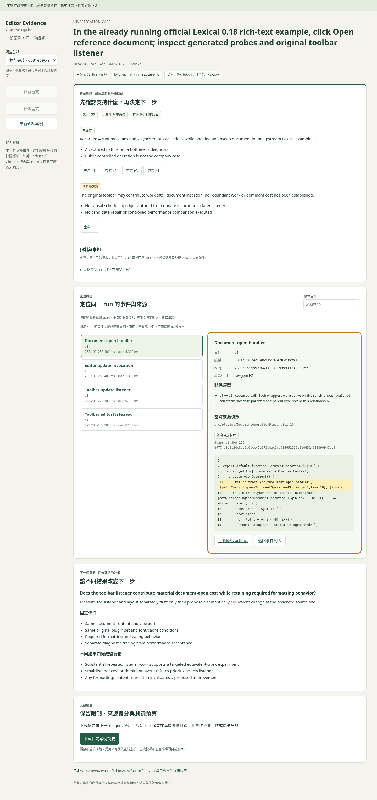

# 公開 runtime 證據，非公司資料

`public-case/` 是本輪官方 Lexical 0.18 rich-text 例子的完整封存 case，含 baseline 與 instrumented 兩次 attempt、原始事件、trace、來源快照與 seal。它是**實際公開範例錄製**，不是公司瓶頸，也不是盲測。

只需 Node 24，從 repo 根目錄執行：

```sh
node debug-core/cli.mjs query --case debug-core/evidence/public-case --limit 2
node debug-core/cli.mjs serve --case debug-core/evidence/public-case
```

打開印出的 loopback URL，點 `e3` 看 toolbar listener，再看與 `e4` 的 captured-call；`e2 → e3` 僅為 temporal association。這不證明 toolbar 是瓶頸。Ctrl+C 關閉。

封存保留原 root、deadline 與來源身分；其他機器找不到原專案時，來源顯示 stale/missing 是正確行為，保存快照仍可查證。不要修改 manifest 來偽裝當前來源或重設期限；也不要對本封存執行 run。新公司調查使用新 case 與已授權 project root。OpenCode 唯讀工具要求 active project root containment，因此此跨機歷史例子先用 CLI/viewer，而不是繞過該界線。

核心程式 SHA-256 必須與 case 相符，repo 已指定核心 LF 與封存資料不轉換行尾。未來升級核心時保留對應的工具 checkout；不靜默用新版 validator 重新判定舊證據。這不是防惡意竄改的簽章。

[runtime 版本與來源紀錄](../examples/lexical-rich/verification.json) · [browser navigation](navigation-check.json) · [fresh-agent smoke](handoff-check.json) · [完整交付](../VALIDATION.md)


