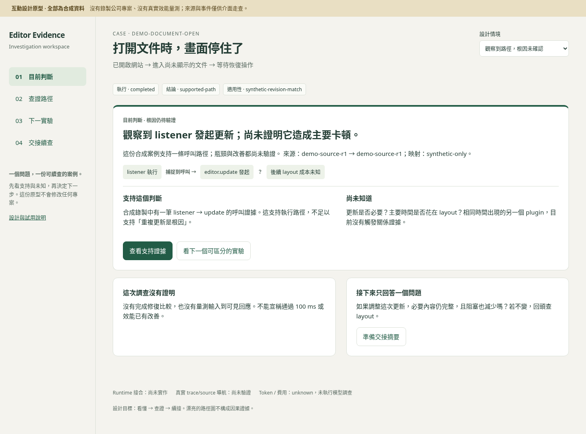

# Agent Debug DX 互動設計原型

全部內容為合成資料。這是資訊架構與互動設計，不是 editor collector、Perfetto 接合、真實效能量測或 OpenCode 工具。不要輸入公司資料；本頁沒有匯入或資料上傳功能。

無需 npm install：直接用瀏覽器開啟本目錄 `index.html`。或在 repository 根目錄啟動：

```sh
python3 -m http.server 4318 --bind 127.0.0.1 --directory design/agent-debug
```

開啟 `http://127.0.0.1:4318`；用 Ctrl+C 停止。Windows 可使用 `py -m http.server ...`。若 port 已占用，換一個 port，不停止不相關服務。原型不依賴外部資源，GitHub 上點 HTML 原始碼不會直接執行。

## 五步走查

1. 讀目前判斷，說明哪些是觀測、哪些尚未確認。
2. 點「查看支持證據」，選另一事件，再返回；檢查焦點與 run 身分。
3. 顯示相鄰事件：e2 與 e3 時間相同，判斷是否能據此建立因果。
4. 切換「證據版本過期」「缺少來源映射」「調查已達 30 分鐘」，確認不同限制沒有被成功狀態蓋過。
5. 看下一實驗，下載交接 JSON；確認帶著限制、反例與停止原因，而非只帶一句根因。

JSON 的 `kind=agent-debug-dx-design` 是設計專用格式，現有 editor-evidence CLI/plugin 不接受它。使用者任務評估、公司 runtime、真實 viewer/source 導航尚未驗證。

契約與兩輪流程：[DX 設計](../../docs/AGENT-DEBUG-DX.md)。原型使用 system fonts、無第三方 runtime dependencies，僅頁面記憶體保存狀態。

## 本輪驗證

已用 Chromium 完成 19 項 [browser check](review/browser-check.json)，包括事件與焦點導航、過期/缺失來源、相鄰非因果事件、deadline 交接、JSON 匯出與四個窄畫面。獨立靜態 review 的 3 項問題已修正。人類任務與真實 runtime 尚未驗證。

已有 Python Playwright 及 Chromium 時可重跑：

```sh
python3 design/agent-debug/verify.py
```

預設 Chromium 為 `/usr/bin/chromium`；其他安裝路徑可透過 `BROWSER_PATH` 指定。腳本不自動安裝套件或瀏覽器；輸出在忽略的 `results/dx-design/`，使用自己的暫時 loopback server 並在結束時關閉。


