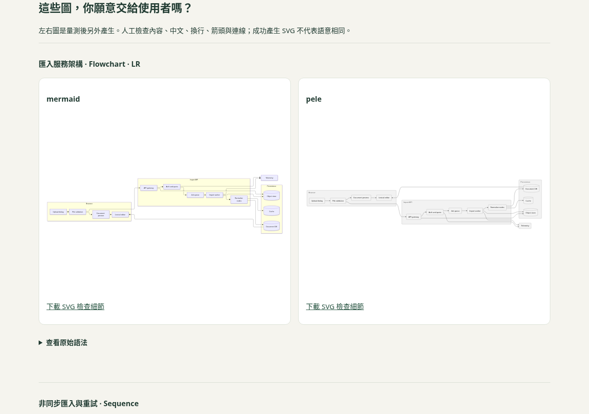

# Renderer 實驗交付與驗證

日期：2026-11-10 UTC。來源 commit：`c272d4e`。以下只適用公開合成 renderer 實驗，未接入公司 editor。

## 已執行

- root `npm run doctor`：17/17 直接依賴符合版本；`--renderer`：4/4。此機無 OpenCode，未重新宣稱 V2 Web 接合通過。
- root `npm run test:rules`：27 tests 通過；production build 通過；`npm run test:ux` 的 6 組檢查通過，無 page/console errors。
- renderer `npm test`：3 項規則測試；真實 Chromium 以 11 張圖／2 組配對執行，確認兩套都產生 SVG、預覽圖片解碼、JSON 實際下載、390/640/1280 px 無頁面水平溢出、停止及尺寸變動後禁止彙總、斷網 context 中載入完整 HTML 報告，無 page/console errors 或外部 HTTP 請求。
- renderer `npm run bench`：在乾淨 `c272d4e` 上執行預設 10 張／5 組 AB/BA 配對，全部原始樣本保留。執行時沒有同時進行其他 benchmark。
- 已加入獨立 GitHub Actions job，使用實驗 lockfile 與 Playwright Chromium；遠端執行狀態以該 PR Actions 為準。

規則/UI 驗證在 commit 前完成，build hash 與乾淨 commit 的預設 benchmark 相同：`650c704dec85` 開頭。驗證記錄見 [browser-verification.json](evidence/renderer-c272d4e/browser-verification.json)。測試只確認 SVG 可產生/顯示與流程，不是完整人工語意或可用性審查。

## 可追查的預設樣本

[摘要](evidence/renderer-c272d4e/summary.json) · [實驗條件](evidence/renderer-c272d4e/experiment.json) · [全部原始樣本](evidence/renderer-c272d4e/samples.json) · [runtime](evidence/renderer-c272d4e/runtime.json) · [離線 HTML 報告](evidence/renderer-c272d4e/report.html)

HTML 可在 clone 後以瀏覽器開啟；GitHub 檔案頁需下載原檔。自動驗證將匯出原文直接載入 offline browser context；OS 檔案關聯及 `file://` 開啟方式未列為已驗證。

本次 Linux x64／Node 24.22.1／Chromium 156，1280×900、DPR 1、headless、每筆先暖機：

| 指標（10 張圖合計） | Mermaid 中位數 | Pele 中位數 | 配對 B−A 中位數 |
|---|---:|---:|---:|
| 生成呼叫至回傳 | 791.0 ms | 9.5 ms | −778.9 ms |
| innerHTML 寫入 | 7.6 ms | 4.9 ms | −2.5 ms |
| 生成開始至最後插入後兩次 rAF | 802.0 ms | 33.3 ms | −768.9 ms |

配對差值中位數不是兩組中位數相減。五組均見 Pele 較低，但只是這套 fixtures/環境的描述性結果，未做統計顯著推論。第三列不是 paint 完成或可互動時間；原生 renderer 快取、輸出結構差異都在實驗介入內。

**Observed：**此組圖表的 renderer 生成成本有值得帶進 editor 驗證的差異。

**Inferred：**更換 renderer 可能減少公司注入時的部分工作；需要相同 component 生命週期的實驗支持。

**Unknown：**公司根因、實際 renderer 版本、冷啟動、輸入延遲、中文/連線完整語意、互動/主題/圖示功能相容性，以及新機/內網上的效果。

## 驗證過程修正

- 補上預覽圖片解碼與尺寸檢查，避免只驗證字串含 SVG 就宣稱畫面可見。
- 外觀對照改成 SVG image，減少嵌套 frame 的捲動/點擊時序問題。量測區仍是原始 SVG DOM 插入。
- 中文案例含 ` `；Mermaid 回傳可供 HTML 插入的 ` `，直接當 XML image 會失敗。只在量測外對預覽做 DOM 解析／XML 序列化；原始繪圖計時與 source 不變。
- 離線驗證只攔 HTTP，避免錯將本機內容攔下。Chrome tracing 未開啟，沒有把 trace 樣本混入量測。

## 下一個可否證實驗

先由使用者在 [公司入口](COMPANY-START.md) 檢查圖表呈現。若可接受，在公司 Lexical 0.18.0 的獨立 worktree 固定同一張圖、component 生命週期與字型，只換 renderer，分別用 20k/50k/80k 周圍文件；分開看生成、插入後成本與實際輸入延遲。如果生成差異沒有轉成操作改善，就回到 layout／plugin／observer 證據，而非繼續堆套件。
